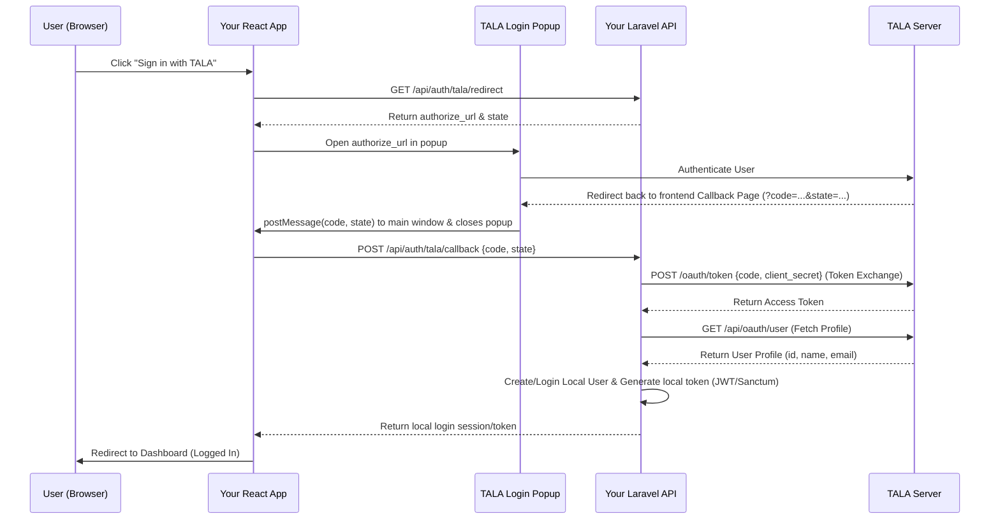

# TALA SSO Integration Guide

This guide explains how to integrate TALA Single Sign-On (SSO) into any web application using the official **React Frontend SDK** and **Laravel Backend SDK**.

---

## Architecture Overview

TALA SSO uses a secure OAuth 2.0 Authorization Code Flow with PKCE:



---

## 1. Backend Integration (Laravel)

### Installation
The SDK repos are private. Get access and set up your SSH key first: see
[private-repo-access.md](private-repo-access.md).

Add the repository to your `composer.json`:
```json
"repositories": [
    {
        "type": "vcs",
        "url": "git@github.com:<owner>/sso-laravel.git"
    }
]
```
Then run:
```bash
composer require tala/sso-laravel
```

### Configuration
Publish the config file:
```bash
php artisan vendor:publish --tag=tala-sso-config
```
Add the following credentials to your `.env` file:
```env
TALA_OAUTH_BASE_URL=https://tala.example.com
TALA_OAUTH_CLIENT_ID=your-tala-client-id
TALA_OAUTH_CLIENT_SECRET=your-tala-client-secret
TALA_OAUTH_REDIRECT_URI=https://your-app.com/auth/tala/callback
# Optional: only these TALA teams may sign in (comma-separated). Missing/unknown team is rejected.
TALA_ALLOWED_TEAMS=
```

### Security settings (v1.1+)
The package now verifies the OAuth `state` and uses PKCE (S256). The state is stored in your
Laravel cache for 10 minutes and can be used once, so **your cache driver must be shared across
servers and must not be `array`** (use `file`, `redis`, `database`, etc.).

| Env | Default | Purpose |
| --- | --- | --- |
| `TALA_VERIFY_STATE` | `true` | Require the callback `state` to match a login this backend started. `false` only as a temporary bridge for older frontends. |
| `TALA_PKCE` | `true` | Send a PKCE challenge and verifier. |
| `TALA_STATE_TTL` | `600` | Seconds a login attempt stays valid. |
| `TALA_CACHE_STORE` | app default | Cache store used for state. |
| `TALA_ALLOWED_TEAMS` | empty | Team allow-list. |

Upgrading from v1.0.x: the React button from `@tala/sso-react` 1.0.x already sends `state`,
so no frontend change is needed for the state check. Make sure the cache requirement above is met.

### Implementing the Login Handler
SSO logic varies depending on how your app manages sessions (e.g., Sanctum vs. JWT). Create a handler class implementing `Tala\SSO\Contracts\TalaLoginHandlerInterface` to handle local user resolution:

```php
<?php

namespace App\Auth;

use App\Models\User;
use Illuminate\Support\Str;
use Tala\SSO\Contracts\TalaLoginHandlerInterface;

class TalaLoginHandler implements TalaLoginHandlerInterface
{
    public function handle(object $talaUser): array
    {
        // 1. Resolve or create the local user. Key on TALA's stable `id`, never on email
        //    (email can change). Needs a nullable, unique `tala_id` column on users.
        $localUser = User::where('tala_id', $talaUser->id)->first();

        if (!$localUser) {
            $localUser = User::create([
                'tala_id' => $talaUser->id,
                'email' => $talaUser->email,
                'name' => $talaUser->name ?? trim(($talaUser->first_name ?? '') . ' ' . ($talaUser->last_name ?? '')),
                'email_verified_at' => now(),
                'password' => bcrypt(Str::random(40)), // Satisfy NOT NULL constraint
                'tala_access_token' => $talaUser->oauth_token, // Saved for logout
            ]);
        } else {
            $localUser->update([
                'name' => $talaUser->name ?? trim(($talaUser->first_name ?? '') . ' ' . ($talaUser->last_name ?? '')),
                'tala_access_token' => $talaUser->oauth_token,
            ]);
        }

        // 2. Generate your session token (Sanctum example)
        $token = $localUser->createToken('auth-token')->plainTextToken;

        // 3. Return the payload that goes back to the React app
        return [
            'token' => $token,
            'user' => [
                'id' => $localUser->id,
                'name' => $localUser->name,
                'email' => $localUser->email,
            ],
        ];
    }
}
```

Existing users that were created by email need a one-time backfill of `tala_id` (match by
email, then store the TALA `id`). Back up the database first and review any unmatched users.

To show a message to the user from your handler, throw `Tala\SSO\Exceptions\TalaAuthException`.
Any other exception is logged and the browser only sees "Authentication failed."

Point to this handler inside `config/tala-sso.php`:
```php
'login_handler' => \App\Auth\TalaLoginHandler::class,
```

### Logout (revokes the token at TALA)
Create a resolver that returns the stored TALA token for the signed-in user:
```php
class TalaTokenResolver implements \Tala\SSO\Contracts\TalaTokenResolverInterface
{
    public function resolve(\Illuminate\Http\Request $request): ?string
    {
        return $request->user()?->tala_access_token;
    }
}
```
Then set `'token_resolver' => \App\Auth\TalaTokenResolver::class` and
`'logout_middleware' => ['api', 'auth:sanctum']` in `config/tala-sso.php`. Call
`POST /api/auth/tala/logout` from your app's logout flow, before you delete the local token.
Without a resolver the route returns 501.

---

## 2. Frontend Integration (React)

### Installation
The package lives in the private `<owner>/sso-react` repo. After setting up your SSH key (see the
access guide above), install it from git. Use a release tag once one exists; until then, pin to
a commit or use `#main`:
```bash
npm install "git+ssh://git@github.com/<owner>/sso-react.git#v1.1.0"
```
The package builds itself on install (`prepare` script).

The button only accepts messages from the popup it opened, from your app's own origin, and
checks the returned `state`. If your callback page is on a different origin than the page with
the button, pass that origin to both: `<TalaLoginButton allowedOrigin="..." />` and
`<TalaCallback targetOrigin="..." />`.

### Callback Route
Create a dedicated route for the callback at `/auth/tala/callback`. This route will be loaded inside the popup and automatically communicate credentials back to your main window.

```tsx
import React from 'react';
import { TalaCallback } from '@tala/sso-react';

export default function CallbackPage() {
  return <TalaCallback />;
}
```

### Sign In Page
Import and place the `TalaLoginButton`. When clicked, it hits your backend's redirect endpoint, generates the secure state, opens the popup, and waits for authentication to complete:

```tsx
import React, { useState } from 'react';
import { useNavigate } from 'react-router-dom';
import { TalaLoginButton } from '@tala/sso-react';

export default function LoginPage() {
  const navigate = useNavigate();
  const [error, setError] = useState<string | null>(null);

  const handleTalaSuccess = (code: string, state: string) => {
    // Send code to backend to complete exchange
    fetch('https://your-api.com/api/auth/tala/callback', {
      method: 'POST',
      headers: { 'Content-Type': 'application/json' },
      body: JSON.stringify({ code, state }),
    })
      .then((res) => res.json())
      .then((response) => {
        if (response.success) {
          // Save token & user profile in state management (e.g., Zustand, Redux)
          localStorage.setItem('token', response.data.token);
          navigate('/dashboard');
        } else {
          setError(response.error || 'Authentication failed.');
        }
      })
      .catch(() => setError('Server network error.'));
  };

  return (
    <div>
      <h1>Login to Your App</h1>
      <TalaLoginButton
        loginUrl="https://your-api.com/api/auth/tala/redirect"
        onSuccess={handleTalaSuccess}
        onLoginError={(err) => setError(err)}
        className="sso-btn"
      >
        Sign in with TALA
      </TalaLoginButton>
      {error && <p className="error">{error}</p>}
    </div>
  );
}
```

---

## 3. Registering the Application in TALA

To finalize integration, you must register your application on the TALA SSO Dashboard:

1. **Create OAuth Client**: Go to the TALA dashboard and create a new client.
2. **Authorized Redirect URI**: Add your exact frontend callback URL. Note: Leading/trailing slashes and protocols must match exactly.
   - Example: `https://your-app.example.com/auth/tala/callback`
3. **Copy Keys**: Grab the **Client ID** and **Client Secret** and add them to your backend's `.env`.
